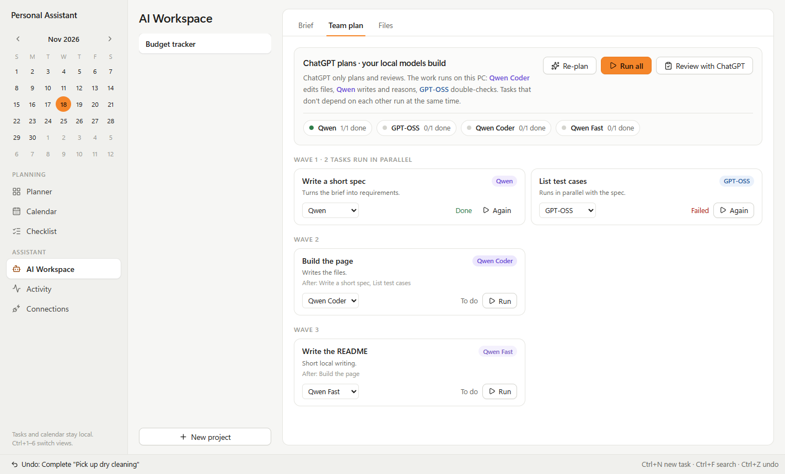

# Local Personal Assistant

A Windows desktop app for your day (planner, calendar, checklist) with a built-in **multi-model AI team**:
**ChatGPT plans and reviews, local models on your PC do the work, several at the same time.**



## What it does

- **Planner** — three day columns of tasks plus an hourly schedule for the selected day.
- **Calendar** — month grid with events and due tasks; side panel for the selected day.
- **Checklist** — search (title and notes) with status / priority / due filters.
- **AI Workspace** — write a brief, then:
  1. **Plan with ChatGPT** → ChatGPT splits the brief into tasks, assigns each to a worker and sets dependencies.
  2. **Run all** → tasks run on local models; tasks that don't depend on each other run **in parallel** (default up to 3).
  3. **Review with ChatGPT** → ChatGPT checks the results and the files, and adds follow-up tasks if needed.
- **Activity** — every agent run with its output. **Connections** — which workers are ready, model per worker,
  on/off switches, "Warm up models".
- Undo (Ctrl+Z) for completing/reopening and deleting tasks and events. Ctrl+N new task, Ctrl+F search, Ctrl+1–6 views.

## The team

| Worker | Default model | Job | Runs |
|---|---|---|---|
| **ChatGPT** | your ChatGPT plan via the Codex CLI | plans and reviews only, never does the work | cloud, read-only, you approve each send |
| **Qwen Coder** | `qwen3-coder:30b` | writes and edits files in the project folder | local |
| **Qwen** | `qwen3:30b` | specs, drafts, reasoning about sub-problems | local |
| **Qwen Fast** | `qwen3:4b` | extraction, reformatting, short summaries | local |
| **GPT-OSS** | `gpt-oss:20b` | second opinions, checking logic and text | local |
| **Claude** (off by default) | your Claude Pro via Claude Code | large builds the local coder can't manage | cloud, you approve each send |

If ChatGPT is unavailable, the strongest local model plans with the same instructions; if that fails, a fixed
plan is used (spec ∥ test cases → build → check).

**Safety:** the local coder can only list, read and write files inside its project folder through tools the
app implements (no shell, no network, no running code). ChatGPT runs read-only. API-key environment variables
are removed for cloud CLIs, so only your subscriptions are used, never pay-per-use API billing. Calendar and
checklist data are never sent to any model.

## Requirements

- Windows 10/11, [Node.js](https://nodejs.org) 22+ (24 recommended)
- [Ollama](https://ollama.com) with the models you want:
  `ollama pull qwen3-coder:30b`, `ollama pull qwen3:30b`, `ollama pull qwen3:4b`, `ollama pull gpt-oss:20b`
  (about 52 GB together; the 30B models need ~20 GB of memory each while loaded)
- For ChatGPT planning: the ChatGPT **Codex** app or `npm install -g @openai/codex`, signed in with `codex login`
  (the app also finds the copy bundled with the Codex desktop app)
- Optional: Claude Code (`claude auth login`)

## Run

    npm install
    npm start            # build and open the app (or double-click "Personal Assistant.cmd")
    npm test             # 11 automated tests
    npm run typecheck
    npm run shot         # render every view to data\screenshots\*.png

Data lives in `data\` next to the app (`PA_DATA_DIR` overrides). `PA_MAX_PARALLEL` sets how many workers run at
once (default 3). Connections → "Import from old app" copies tasks/events/projects from the earlier tkinter
version's database, opened read-only.

## Stack

Electron 45 (Node 24) · React 19 · TypeScript · Vite 8 · Tailwind CSS 4 · Motion · lucide icons ·
SQLite via Electron's built-in `node:sqlite` (no native modules).

```
src/main/        Electron main process
  db.ts          storage, undo journal, steps with dependencies, import
  providers.ts   Ollama (node:http, keep-alive), Codex/ChatGPT and Claude CLIs, status checks
  localcoder.ts  file-tool agent loop for local coding models (incl. qwen3-coder's text tool calls)
  orchestrator.ts planner/reviewer prompts, plan parsing, dependency waves, fallback plan
  main.ts        window, IPC, the parallel scheduler
src/renderer/    React UI (App shell, design system in ui.tsx, one file per view)
src/shared/      types, workers, dates, filters (pure, tested)
tests/           node:test suite
```

Design follows Emil Kowalski's design-engineering notes: instant view switches (views stay mounted), press
feedback on buttons, short ease-out dialogs and toasts, visible focus rings, reduced-motion respected.

## Notes

- The first use of a 30B model loads it from disk (minutes on a hard drive); it then stays in memory for
  30 minutes. Use **Warm up models** before a session.
- Codex's own `--oss` mode hung on Windows in testing, so local coding uses the app's own tool loop instead.
- See `AGENTS.md` for the rules AI agents follow when working on this repository.
